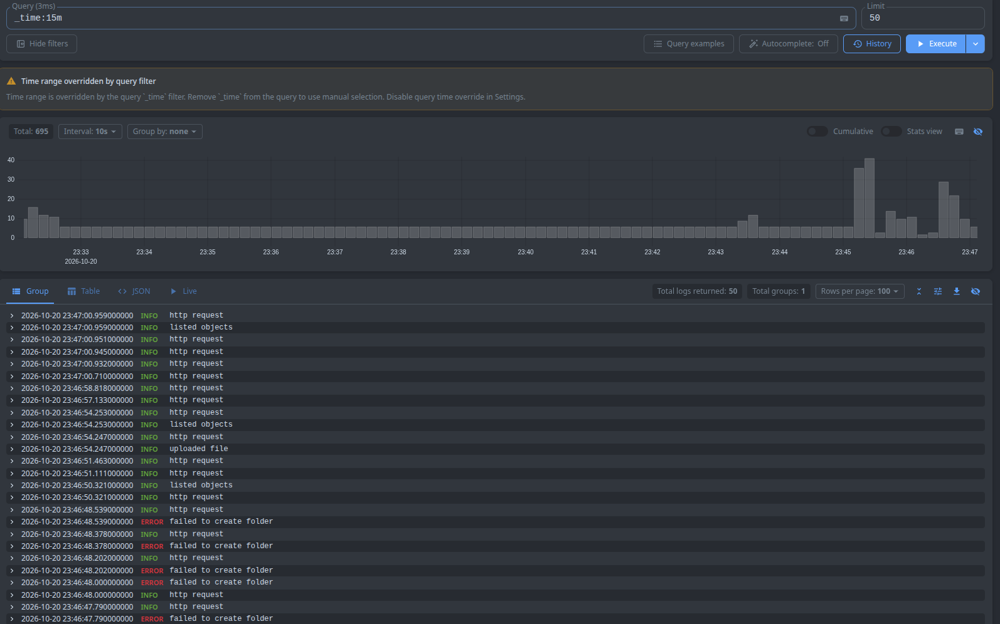
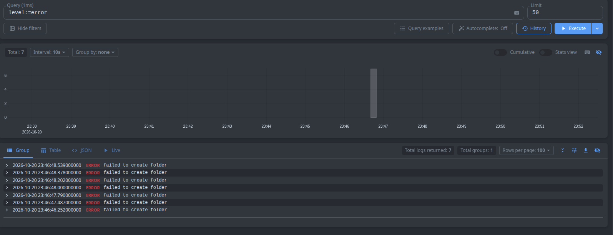
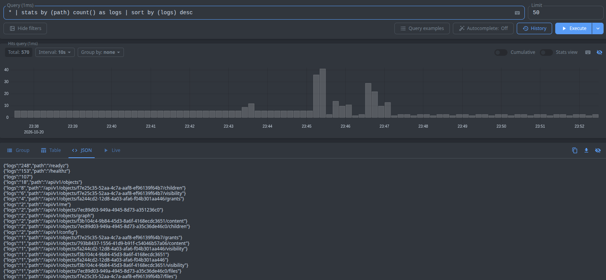
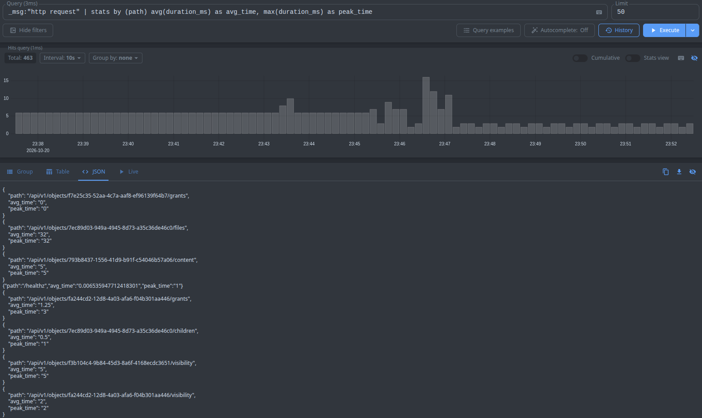

## Сырые записи за последние N минут
Запрос: `_time:15m` - логи за последние 15 минут

## Фильтр по конкретному полю
Запрос: `level:=error` - ошибки

## Stats-запрос с группировкой
Запрос: `* | stats by (path) count() as logs | sort by (logs) desc` - количество запросов по определённому пути

## Агрегирующий запрос
Запрос: `_msg:"http request" | stats by (path) avg(duration_ms) as avg_time, max(duration_ms) as peak_time` - максимальное и среднее время ответа, сгрупированные по пути

