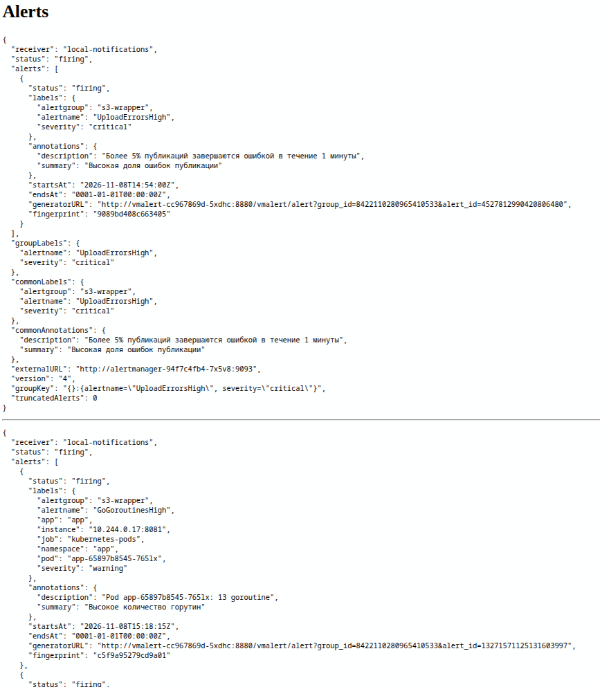
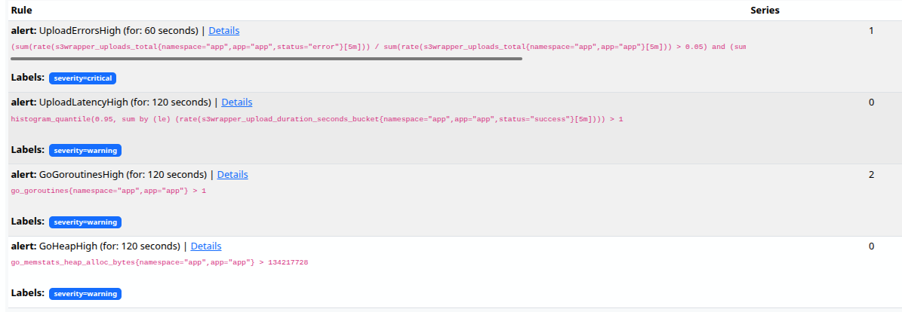

# Алерты

## Алерты на метрики сервиса
### UploadErrorsHigh
Ошибки загрузок > 5% за 5 минут, минимум 5 попыток, условие держится 1 минуту
Обнаруживает недоступность публикации

### UploadLatencyHigh
p95 успешных загрузок > 1 с за 5 минут в течение 2 минут
Нужен для обнаружения ухудшение времени записи

## Алерты на метрики рантайма
### GoGoroutinesHigh
\> 200 goroutine в одной реплике в течение 2 минут 
Ловить утечки goroutine 

### GoHeapHigh
Занятая Go heap > 128 МиБ в одной реплике в течение 2 минут 
Следить за потреблением памяти

Для демонстрации понизил порог горутин для 1й
