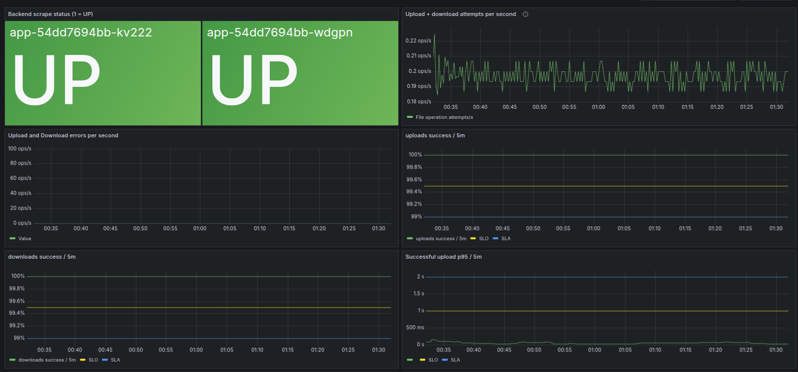
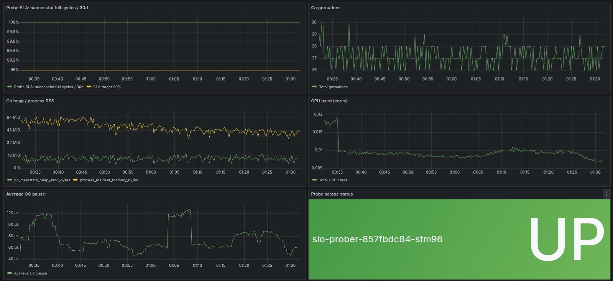
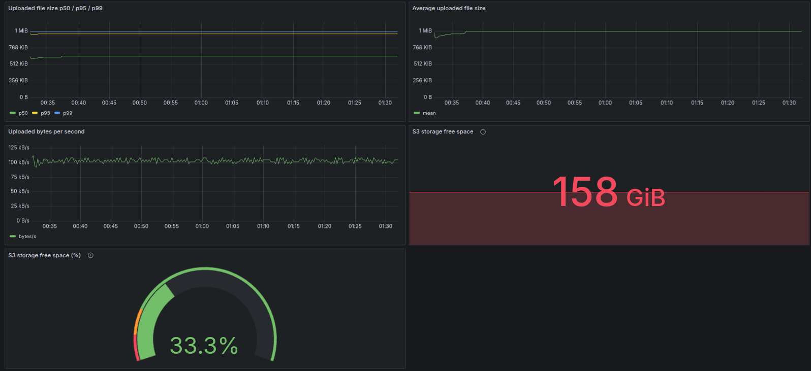
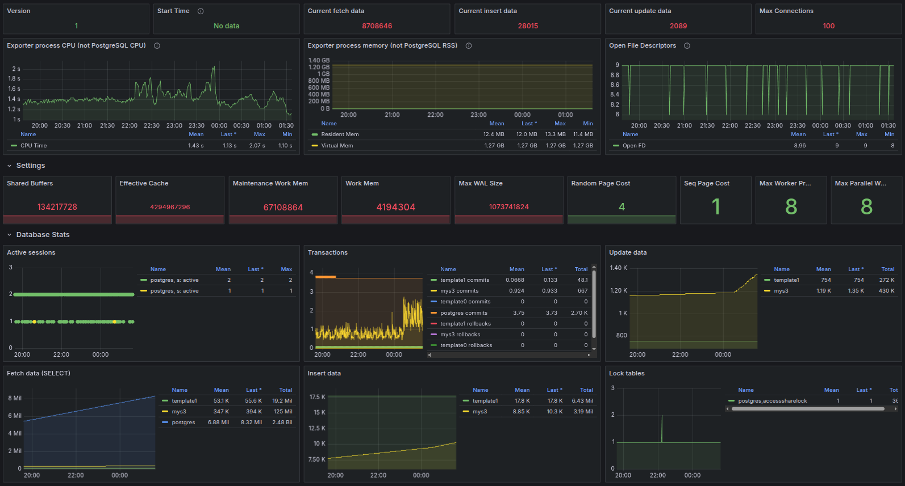

## Источники данных
Источник данных - виктория метрикс. Метрики поступают от приложения и Go runtime, пробера, PostgreSQL Exporter и Node Exporter для диска RustFS.

## Дашборд приложения

### 1. Backend status
Успех сборки метрик с бэкенда

### 2. Upload + download attempts per second
Сумма попыток загрузки и открытия скачивания в секунду. Интенсивность нагрузки

### 3. Upload and Download errors per second
Количество ошибок публикаций и скачивания в секунду

### 4. uploads success / 5m
Доля успешных публикаций за 5 минут

### 5. downloads success / 5m
Доля успешных скачиваний за 5 минут 

### 6. Successful upload p95 / 5m
Оценка времени успешных публикаций

### 7. Probe SLA: successful full cycles / 30d
Доля успешных полных проверок пробера за 30 суток

### 8. Go goroutines
Количество горутин

### 9. Go heap / process RSS
Потребление памяти

### 10. CPU used (cores)
Суммарное потребление CPU приложением в ядрах

### 11. Average GC pause
Среднее время остановки приложения сборщиком мусора. Помогает проверить, связаны ли задержки загрузки с GC.

### 12. Probe status
Успех сбора метрик с пробера

### 13. Uploaded file size p50 / p95 / p99
Оценки размеров загруженных файлов

### 14. Average uploaded file size
Средний размер успешно загруженного файла за 5 минут

### 15. Uploaded bytes per second
Объём успешно загруженных файлов в байтах в секунду

### 16. S3 storage free space
Свободное место в s3

### 17. S3 storage free space (%)
Доля свободного места

## PostgreSQL
https://grafana.com/grafana/dashboards/9628-postgresql-database/

Скринкаст не делал, на скринах вроде все есть))